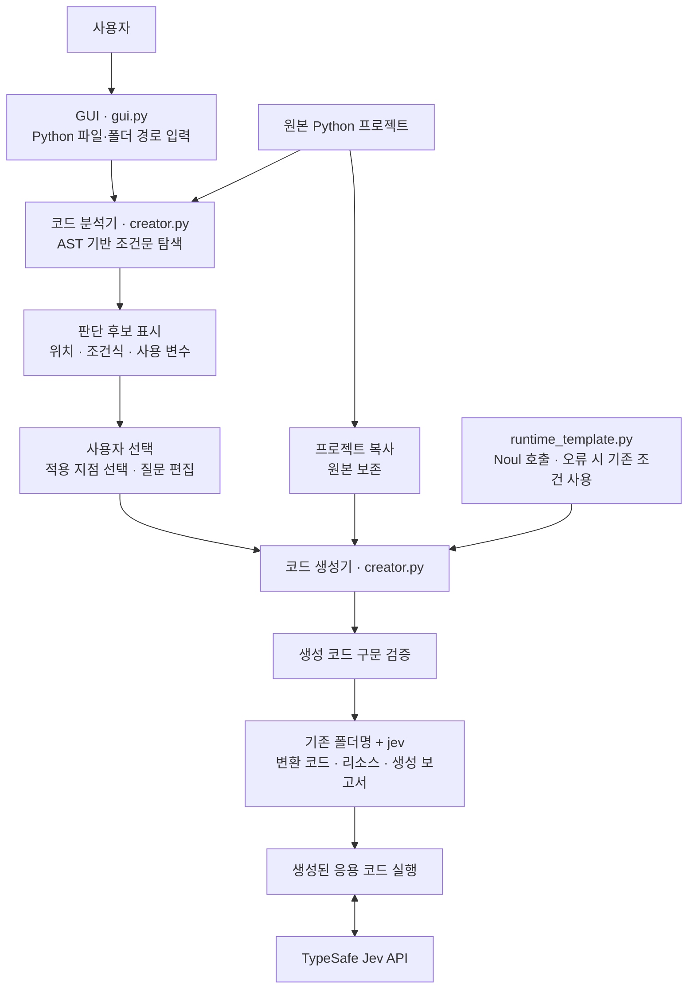

# Python JEV Creator

Python 코드에서 판단 지점을 제안하고 사용자가 선택한 조건에 TypeSafe AI 공식
Jev 호출 코드를 추가하는 Tkinter 데스크톱 프로그램입니다. Python 3.9 이상에서
실행하며 별도 패키지는 필요하지 않습니다. Linux는 python3-tk가 필요할 수 있습니다.

## 소프트웨어 구조

아래는 구현된 Creator의 구조입니다. 분석과 생성은 로컬에서 수행하며,
Jev API는 생성된 응용 코드를 실행할 때 호출합니다.



`main.py`가 GUI를 시작합니다. Runner와 연결하려면 생성된 프로젝트에
서비스 명세와 실행 어댑터를 별도로 추가해야 합니다.
[Runner 설계](../python_jev_runner/README.md)를 참고하세요.

## 실행 및 사용

저장소 루트에서 실행합니다.

```powershell
py -3.9 apps/agentai/jev/python_jev_creator/main.py
```

Linux/macOS에서는 python3으로 main.py를 실행합니다.

1. Python 파일 또는 프로젝트 폴더를 입력하고 **분석**을 누릅니다.
2. 후보를 클릭하면 원래 조건식, 위치, 전송할 변수와 제안 이유가 표시됩니다.
3. 질문을 편집하고 **현재 후보 선택 / 해제** 또는 더블클릭으로 적용 대상을 선택합니다.
4. **선택한 지점에 Jev 코드 생성**을 누릅니다. 여러 후보를 선택할 수 있습니다.

폴더 C:/work/sample → C:/work/samplejev.
파일 C:/work/sample/main.py → C:/work/samplejev/main.py.
파일 선택은 해당 파일만 복사하므로 로컬 모듈·리소스가 있으면 폴더를 선택하세요.
기존 출력 폴더는 덮어쓰지 않습니다.

## 자동 분석 범위

분석은 로컬 AST 정적 분석으로 API 키가 필요하지 않습니다. if/elif 및 조건부
표현식에서 변수·상수·비교·논리 조건을 제안합니다. 문자열 비교는 분류·라우팅
후보로, 일반 비교는 검토가 필요한 후보로 표시합니다. 함수 호출, 속성 접근,
서브스크립트, 대입 표현식 등은 보수적으로 제외합니다. 코드 의미를 완전히 이해하는
AI 분석은 아닙니다. 질문은 조건식에서 생성한 초안이므로 사용자가 검토·수정해야 합니다.
선택하지 않은 조건은 유지합니다. 겹치는 중첩 후보는 하나만 선택하세요.
권한·보안·정확한 수치 계산 조건은 기존 조건을 유지하는 것이 좋습니다.

## 생성 프로그램 실행

생성한 프로그램을 실행할 터미널에서 환경 변수를 설정합니다.

```powershell
$env:TYPESAFE_API_KEY = '발급받은 키'
$env:JEV_MODEL = 'jev-latest' # 선택 사항
```

키는 소스에 저장하지 않습니다. 키가 없거나 JEV_ENABLED=0이면 기존 조건으로
동작합니다. 키가 있으면 선택한 조건에서 사용한 변수 값이 TypeSafe API로 전송됩니다.
GUI 상세 화면의 전송 변수 목록을 확인하세요. locals/globals 전체는 전송하지 않습니다.
문자열·숫자·불리언·None 이외 객체가 포함된 경우 기존 조건으로 돌아갑니다.

원래 조건은 한 번 평가하고, Jev Noul 확률이 0.8 이상이면 True, 0.2 이하이면
False를 사용합니다. 그 사이 값은 원래 조건 결과를 사용합니다. 10초 타임아웃,
API 오류, 잘못된 응답에도 원래 결과를 사용하고 경고를 표시합니다.
반복문 안의 조건은 실행마다 API 요청을 발생시킬 수 있습니다. 호출은 동기 방식이므로
생성된 프로그램의 응답 시간과 동작이 달라질 수 있습니다.

## 원본 보존과 파일 구성

원본 인코딩·주석·선택하지 않은 코드와 리소스를 보존합니다. Python 파일의 분석 후
변경 여부를 확인하고 변환 결과를 구문 검사합니다. 임시 폴더에서 작업 후 최종
폴더로 이동합니다. 원본 코드를 실행하지 않습니다.
.git, .venv, venv, __pycache__, .pytest_cache는 제외하고 링크/junction은 거부합니다.
결과의 jev_creator_manifest.json에 선택 위치와 질문을 기록합니다.
이미 지원 함수가 삽입된 코드는 재적용을 거부합니다.

- main.py / gui.py: 경로 입력, 작업 스레드, 후보 선택, 질문 편집
- creator.py: AST 분석, 소스 변환, 복사와 검증
- runtime_template.py: 생성 코드에 삽입하는 독립 실행 가능한 API 호출 함수
- tests/test_creator.py: 원본 보존, 복사, 변경 감지, 인코딩, 모의 API 검증

```powershell
py -3.9 -m unittest discover -s apps/agentai/jev/python_jev_creator/tests -v
```

실제 API 키를 사용하는 온라인 연동 시험은 별도로 필요합니다.

## 공식 API 근거

- [System One API](https://docs.typesafe.ai/api/system-one):
  POST https://api.typesafe.ai/v1/systemone, Bearer 인증, model/state/questions 요청,
  answers.decision.noul 응답.
- [Quick Start](https://docs.typesafe.ai/introduction/quickstart):
  TYPESAFE_API_KEY와 jev-latest 예시.

공식 문서 확인일: 2026-10-27. SDK 대신 Python 표준 HTTP 라이브러리로 연동합니다.
